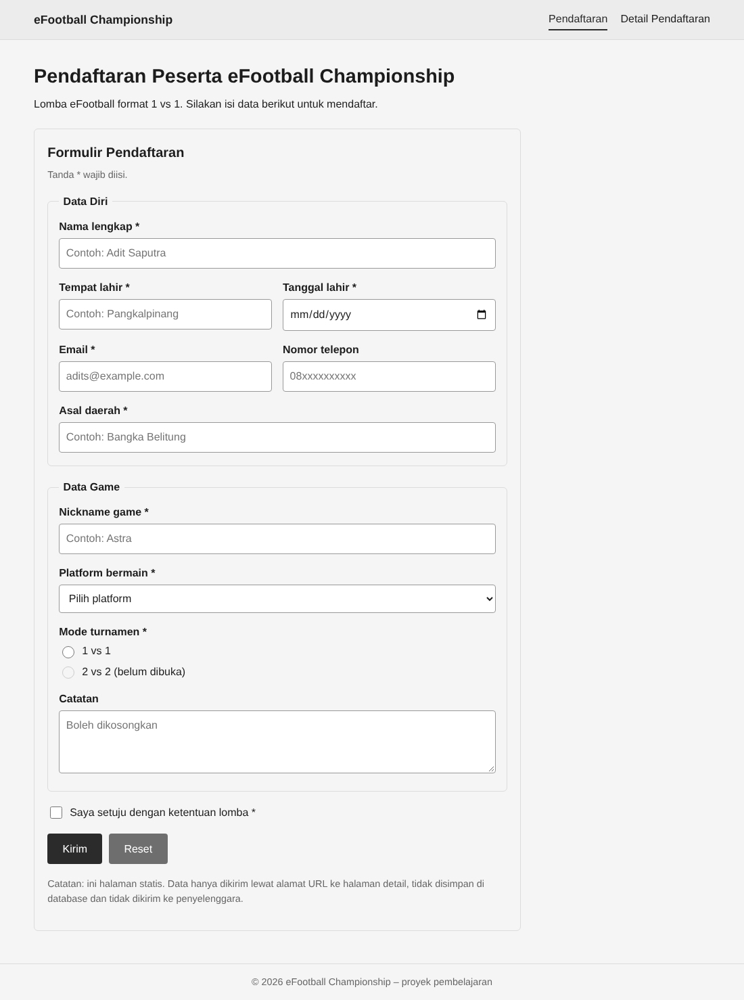
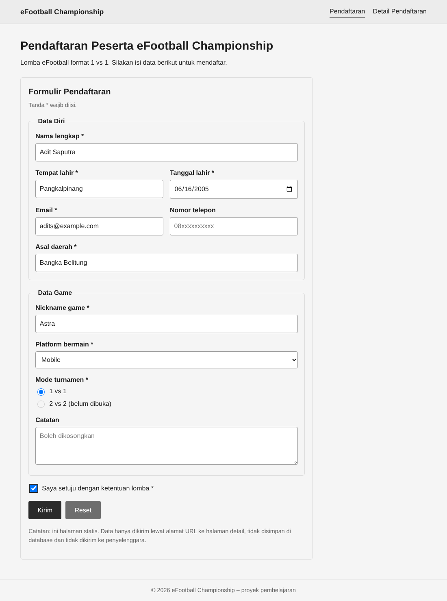
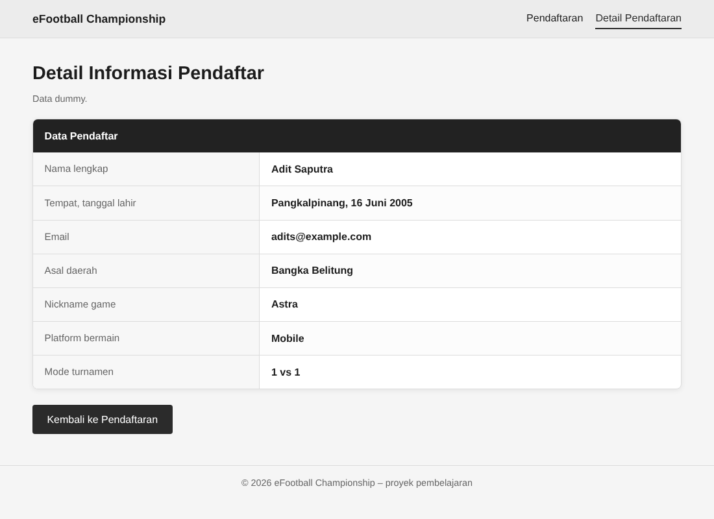
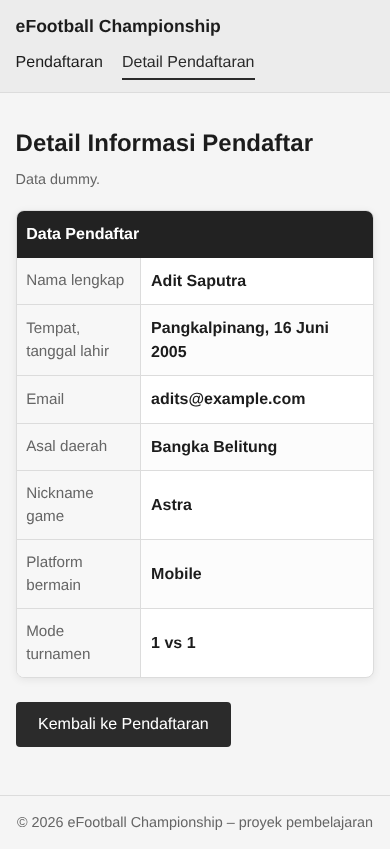

# eFootball Championship – Halaman Pendaftaran

Proyek web statis (HTML + CSS, tanpa JavaScript dan tanpa backend) untuk pendaftaran peserta lomba eFootball format 1 vs 1. Dibuat untuk pembelajaran; semua data hanya contoh (dummy).

## Struktur folder

```
efootball-championship/
├── index.html      # Halaman formulir pendaftaran
├── detail.html     # Halaman detail pendaftar (tabel)
├── style.css       # CSS global untuk kedua halaman
├── screenshots/    # Tangkapan layar tampilan web (dipakai di README)
└── README.md
```

## Tampilan

**Halaman pendaftaran** (`index.html`)



**Formulir yang sudah terisi**



**Halaman detail pendaftar** (`detail.html`)



**Tampilan mobile** (layar sempit)



## Cara menjalankan

Buka `index.html` langsung di browser (klik dua kali). Tidak perlu instalasi atau server.

## Alur halaman

1. Pengguna mengisi formulir di `index.html`.
2. Tombol **Kirim** memicu `<form action="detail.html" method="get">`, sehingga browser membuka `detail.html` dan membawa isian formulir di URL (contoh: `detail.html?nama=...&email=...`).
3. `detail.html` saat ini menampilkan data contoh yang ditulis langsung di HTML. Isian di URL belum dibaca (butuh JavaScript atau backend).

## Penjelasan `index.html`

| Bagian | Fungsi |
|---|---|
| `<header class="site-header">` | Header dengan nama situs dan menu navigasi. Link aktif diberi `class="active"`. |
| `<form>` | Formulir pendaftaran, dibagi dua `<fieldset>`: **Data Diri** dan **Data Game**. |
| `<label for>` + `<input id>` | Label terhubung ke input sehingga bisa diklik dan ramah pembaca layar. |
| `required` | Validasi bawaan browser untuk kolom wajib (ditandai `*`). |
| `type="email"`, `type="date"`, `type="tel"` | Tipe input yang memberi validasi dan tampilan khusus per jenis data. |
| `pattern="[A-Za-z0-9_]{3,}"` | Nickname minimal 3 karakter: huruf, angka, atau underscore. |
| `<select>` | Pilihan platform: PlayStation 5, PlayStation 4, PC, Mobile. |
| Radio `mode` | Mode turnamen. 1 vs 1 aktif, 2 vs 2 `disabled` (belum dibuka). |
| Checkbox `setuju` | Persetujuan ketentuan lomba, wajib dicentang. |
| Tombol `submit` / `reset` | Kirim data atau kosongkan formulir. |

## Penjelasan `detail.html`

Berisi tabel `<table class="info-table">` dengan satu baris per data:

- `<thead>` berisi satu baris judul "Data Pendaftar" yang melebar dua kolom (`colspan="2"`).
- `<th scope="row">` sebagai label baris (Nama lengkap, Email, dst.).
- `<td>` sebagai nilai.

Data contoh: Adit Saputra, Pangkalpinang, 16 Juni 2005, adits@example.com, Bangka Belitung, nickname Astra, platform Mobile, mode 1 vs 1.

## Penjelasan `style.css`

- **Variabel warna (`:root`)**: `--bg`, `--text`, `--muted`, `--border`, `--light`, `--accent`. Ubah di sini untuk mengganti tema seluruh situs. Tema saat ini hitam-putih-abu.
- **Layout**: `.container` membatasi lebar maksimal 1000px dan rata tengah; `.header-inner` memakai Flexbox.
- **Form**: gaya input, `fieldset`, `.field-row` (dua kolom berdampingan), `.choice` (radio/checkbox), dan fokus input dengan outline.
- **Tombol**: `.btn` (utama) dan `.btn-gray` (reset).
- **Tabel**: `.info-table` memakai `border-collapse: separate`, sudut membulat dengan bayangan tipis, kolom label 35% lebar (teks abu, latar abu sangat muda), nilai dicetak tebal, baris judul "Data Pendaftar" berlatar charcoal di dalam tabel, baris selang-seling berwarna sangat muda, dan baris menyala tipis saat di-hover.
- **Latar foto samar**: pada `body`, foto `images/messi.jpg` ditumpuk dengan lapisan putih transparan (`rgba(245,245,245,0.93)`) lewat `background-image`. Kecilkan angka 0.93 agar foto lebih jelas. Jika file foto tidak ada, latar tampil polos.
- **Responsif**: `@media (max-width: 500px)` mengecilkan judul dan menyusun field serta tombol menjadi satu kolom.

## Cara mengubah

- **Ganti data contoh**: edit isi `<td>` di `detail.html`.
- **Ganti warna**: ubah nilai variabel di `:root` pada `style.css`.
- **Ganti foto latar**: timpa `images/messi.jpg` dengan gambar lain (nama file sama), atau ubah path pada `background-image`.

## Keterbatasan dan pengembangan

- Data tidak disimpan dan tidak dikirim ke penyelenggara.
- Agar `detail.html` menampilkan isian pengguna, baca `URLSearchParams` dengan JavaScript, atau gunakan backend.
